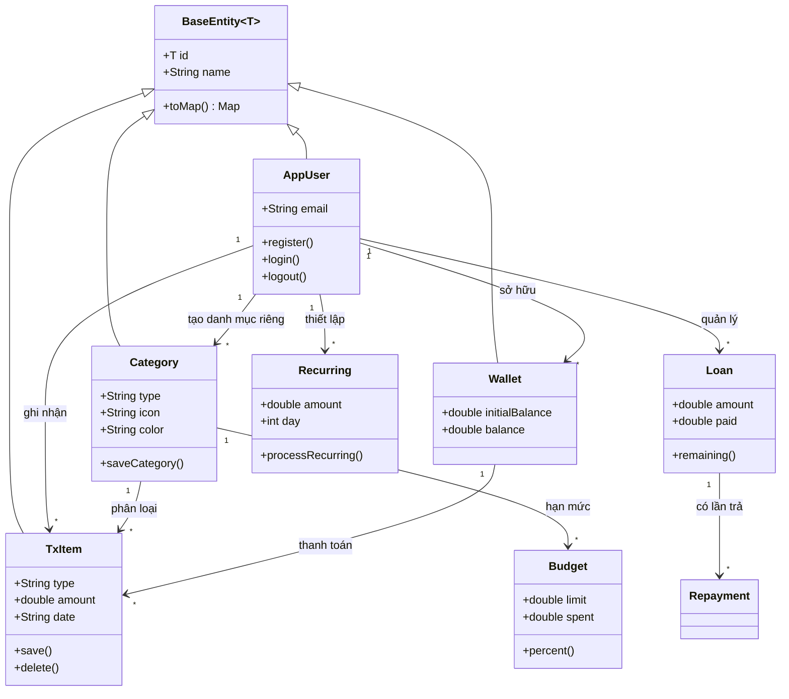
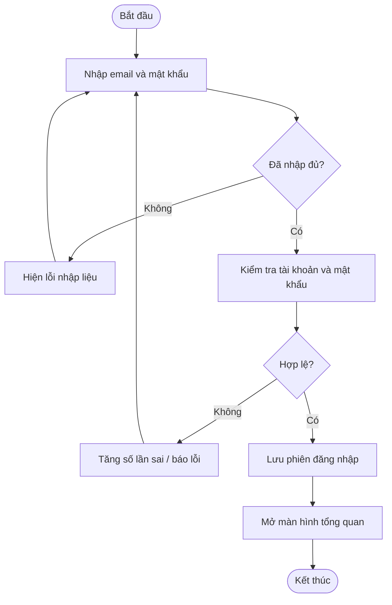
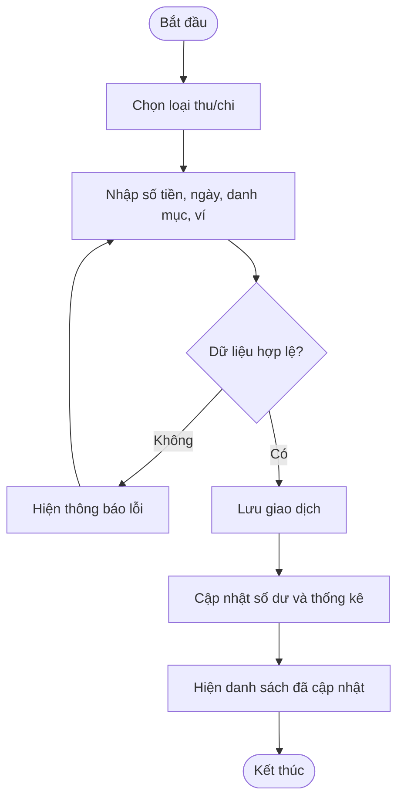
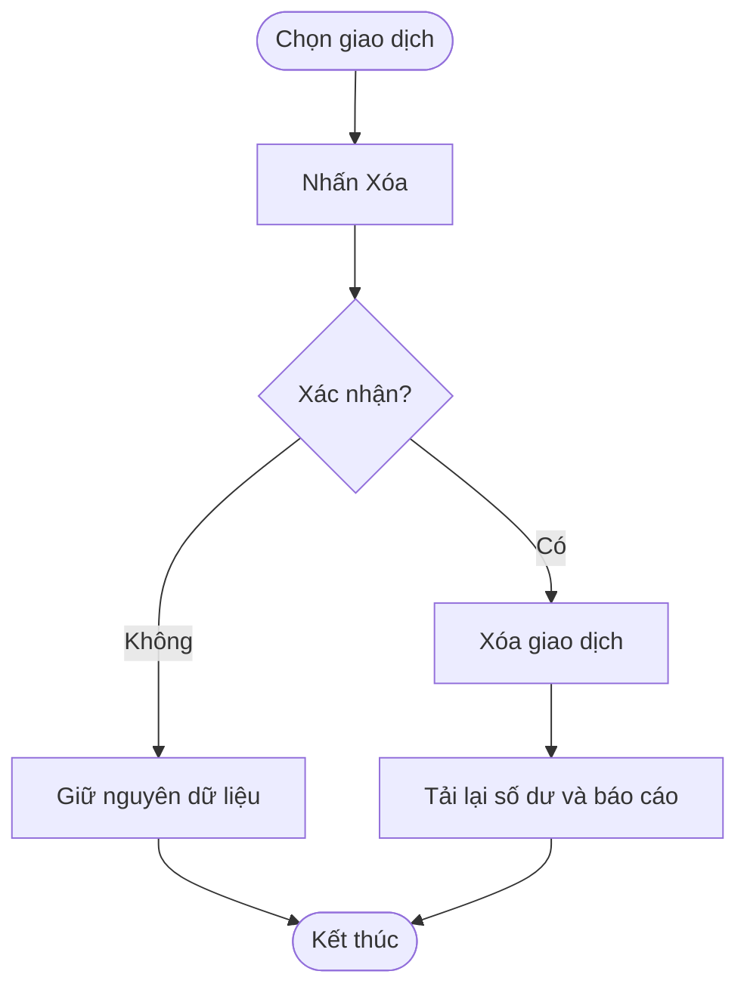
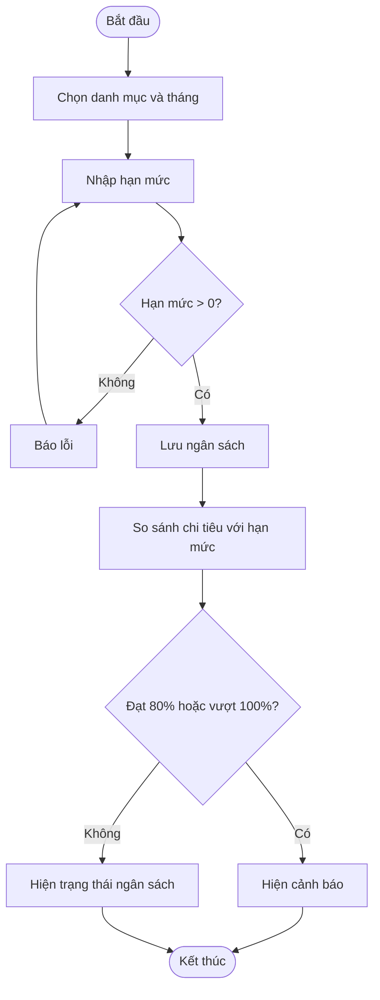
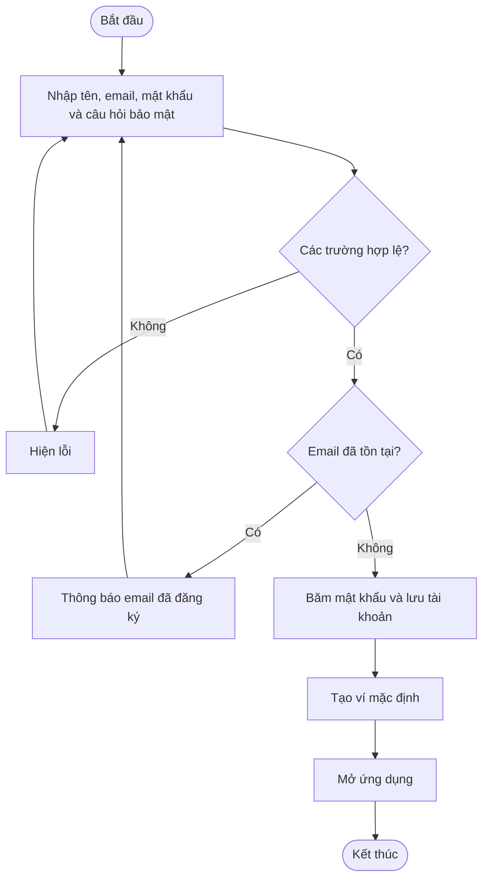
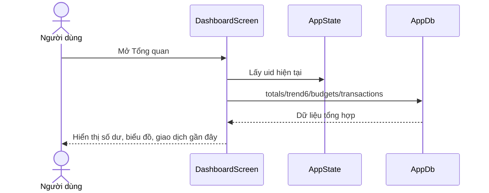

# FINCARE — Hồ sơ đáp ứng yêu cầu đồ án

> Ứng dụng Flutter quản lý tài chính cá nhân. Tên sinh viên, mã sinh viên, thành viên, link demo và link GitHub cần được nhóm điền trước khi in.

## Thông tin nhóm
- Tên project: FINCARE — Quản lý tài chính cá nhân
- Sinh viên / mã sinh viên: **[điền]**
- Thành viên và đóng góp:
  - **[Thành viên 1]** — [phần việc, file, commit cụ thể]
  - **[Thành viên 2]** — [phần việc, file, commit cụ thể]
  - **[Thành viên 3]** — [phần việc, file, commit cụ thể]
  - **[Thành viên 4 nếu có]** — [phần việc, file, commit cụ thể]
- GitHub Repo: **[dán URL repo nhóm]**
- Demo dưới 8 phút: **[dán URL video]**

## Câu 1 — User Stories (nhóm 4 người: 16 stories)
Định dạng: *Là [vai trò], tôi có thể [mục tiêu].*

1. Là khách, tôi có thể đăng ký tài khoản.
2. Là người dùng, tôi có thể đăng nhập bằng email và mật khẩu.
3. Là người dùng, tôi có thể khôi phục mật khẩu bằng câu hỏi bảo mật.
4. Là người dùng, tôi có thể đăng xuất khỏi ứng dụng.
5. Là người dùng, tôi có thể xem tổng số dư và tổng quan thu chi.
6. Là người dùng, tôi có thể thêm một giao dịch thu.
7. Là người dùng, tôi có thể thêm một giao dịch chi.
8. Là người dùng, tôi có thể sửa một giao dịch.
9. Là người dùng, tôi có thể xóa một giao dịch.
10. Là người dùng, tôi có thể tìm kiếm và lọc giao dịch.
11. Là người dùng, tôi có thể quản lý danh mục thu chi.
12. Là người dùng, tôi có thể quản lý ví tiền.
13. Là người dùng, tôi có thể đặt ngân sách theo danh mục.
14. Là người dùng, tôi có thể xem báo cáo thu chi theo thời gian.
15. Là người dùng, tôi có thể quản lý khoản cho vay và đi vay.
16. Là người dùng, tôi có thể thiết lập giao dịch định kỳ.

Với nhóm 3 người, chọn tối thiểu 12 story đầu phù hợp phạm vi thực tế; không khai báo chức năng chưa được triển khai là đã hoàn thành.

## Câu 2 — Phân tích yêu cầu, đối tượng, phương thức và quan hệ

| Đối tượng | Thuộc tính chính | Phương thức / trách nhiệm | Quan hệ |
|---|---|---|---|
| AppUser | id, name, email | register, login, logout, updateName | Một người dùng sở hữu nhiều ví, giao dịch, ngân sách và khoản vay |
| Category | id, name, type, icon, color | tạo/sửa/xóa danh mục; phân loại thu/chi | Một danh mục có nhiều giao dịch; có thể có nhiều ngân sách theo tháng |
| Wallet | id, name, type, initialBalance | tạo/sửa/xóa ví; tính số dư | Một ví có nhiều giao dịch |
| TxItem (Transaction) | id, type, amount, date, note | thêm/sửa/xóa/tìm kiếm giao dịch | Mỗi giao dịch thuộc người dùng; có thể liên kết một danh mục và một ví |
| Budget | id, categoryId, month, limit, spent | đặt hạn mức, tính phần trăm, cảnh báo | Gắn với một danh mục và người dùng |
| Loan | id, borrowerName, type, amount, paid, dueDate | ghi nhận vay/cho vay, trả nợ, tính dư nợ | Một khoản vay có nhiều lần trả nợ |
| Recurring | id, title, amount, day, active | bật/tắt và sinh giao dịch định kỳ | Thuộc người dùng, có thể gắn danh mục/ví |

### Yêu cầu phi chức năng
- Bảo vệ dữ liệu tài chính theo tài khoản; không hiển thị dữ liệu của người dùng khác.
- Không lưu mật khẩu dạng văn bản thuần; thông báo lỗi dễ hiểu.
- Kiểm tra số tiền phải lớn hơn 0, trường bắt buộc không được rỗng.
- Giao diện đọc được trên màn hình điện thoại; xác nhận trước thao tác xóa.
- Khi dùng Firestore, bật Authentication/Rules phù hợp, không để quy tắc đọc ghi công khai trong bản triển khai.

## Câu 3 — Sơ đồ 

### 3.1 Class Diagram


> Sơ đồ mô tả thiết kế logic. Trước khi nộp, đối chiếu lại tên lớp/phương thức trong code cuối cùng; không trình bày lớp minh họa là lớp đã tích hợp nếu nhóm chưa tích hợp.

### 3.2 Activity — Đăng nhập


### 3.3 Activity — Thêm giao dịch


### 3.4 Activity — Xóa giao dịch


### 3.5 Activity — Đặt ngân sách


### 3.6 Activity — Đăng ký


### 3.7 Sequence — Tải tổng quan


## Câu 4 — Wireframes và flow of work

### Màn hình 1: Đăng nhập
```text
┌──────────────────────────┐
│          FINCARE         │
│   Quản lý tài chính      │
│ Email                    │
│ [______________________] │
│ Mật khẩu                 │
│ [______________________] │
│ [       ĐĂNG NHẬP      ] │
│ Đăng ký | Quên mật khẩu  │
└──────────────────────────┘
```
Flow: Mở app → nhập email/mật khẩu → xác thực → thành công vào Tổng quan; thất bại hiển thị lỗi; tài khoản bị khóa thì yêu cầu chờ.

### Màn hình 2: Tổng quan
```text
┌──────────────────────────┐
│ Xin chào                 │
│ SỐ DƯ HIỆN TẠI           │
│          12.500.000 đ    │
│ [Thu tháng] [Chi tháng]  │
│ Trợ lý FINCARE            │
│ Biểu đồ 6 tháng           │
│ Chi theo danh mục         │
│ Giao dịch gần đây         │
│ Trang chủ Giao dịch Ví ...│
└──────────────────────────┘
```
Flow: Mở tab → tải dữ liệu theo uid → tính tổng thu/chi → hiển thị biểu đồ và giao dịch gần nhất → chọn giao dịch để xem/sửa.

### Màn hình 3: Danh sách giao dịch
```text
┌──────────────────────────┐
│ Giao dịch       [Lọc][CSV]│
│ [Tìm kiếm______________] │
│ [Tất cả] [Thu] [Chi]     │
│ Ăn uống     -50.000 đ    │
│ Lương     +8.000.000 đ   │
│ Đi lại      -30.000 đ    │
│                  [+]     │
└──────────────────────────┘
```
Flow: Tải danh sách → người dùng tìm kiếm/lọc ngày/thu chi → chọn dòng để sửa hoặc xóa → xuất CSV nếu cần.

### Màn hình 4: Thêm/sửa giao dịch
```text
┌──────────────────────────┐
│ Thêm giao dịch           │
│ [Chi] [Thu]              │
│ Số tiền                  │
│ [______________________] │
│ Danh mục                 │
│ [Chọn danh mục         v]│
│ Ví                       │
│ [Chọn ví               v]│
│ Ngày                     │
│ [dd/mm/yyyy]             │
│ Ghi chú                  │
│ [______________________] │
│ [Ảnh hóa đơn]            │
│ [         LƯU          ] │
└──────────────────────────┘
```
Flow: Chọn loại → nhập thông tin → kiểm tra số tiền/danh mục → lưu → cập nhật tổng quan; nếu sửa thì điền sẵn dữ liệu; xóa phải xác nhận.

### Màn hình 5: Danh mục
```text
┌──────────────────────────┐
│ Danh mục          [+]    │
│ [Thu] [Chi]              │
│ 🍜 Ăn uống               │
│ 🚗 Đi lại                │
│ 📚 Học tập               │
│ 🧾 Hóa đơn               │
└──────────────────────────┘
```
Flow: Tải danh mục → lọc thu/chi → thêm/sửa/xóa danh mục do người dùng tạo → danh mục mặc định không cho xóa.

### Màn hình 6: Ngân sách
```text
┌──────────────────────────┐
│ Ngân sách     [Tháng v]  │
│ Ăn uống                  │
│ Đã chi 1.200.000/2.000.000│
│ [██████------] 60%       │
│ Đi lại                   │
│ Đã chi 900.000/800.000   │
│ [████████████] 112%      │
│ [ + Tạo ngân sách ]      │
└──────────────────────────┘
```
Flow: Chọn tháng → chọn danh mục → nhập hạn mức dương → lưu → tính chi tiêu thực tế → cảnh báo ở mức 80% và khi vượt 100%.

## Câu 5 — Màn hình mẫu
Chọn màn hình **Thêm giao dịch** (đã có trong `lib/screens/transaction_form_screen.dart`). Chụp ảnh màn hình app chạy trên emulator/điện thoại và chèn tại đây. Ảnh đề `Yeucau.PNG`, `truong-1.PNG`, `anh1-1.png`, `Screenshot 2026-10-23 073043-1.png` chưa có trong gói đính kèm nên cần đối chiếu mẫu chính thức của giảng viên trước khi khẳng định khớp pixel.

## Câu 6 — Code và logic
Các chức năng đang có trong mã nguồn: đăng ký/đăng nhập, tổng quan, CRUD giao dịch, tìm kiếm/lọc/xuất CSV, danh mục, ví, ngân sách, báo cáo, khoản vay, giao dịch định kỳ, hồ sơ và giao diện sáng/tối. Phạm vi thực tế phải được xác minh bằng cách chạy thử trên thiết bị và kiểm tra từng thao tác trước khi báo cáo hoàn thành.

## Câu 7 — Firestore / ORM
Trong `lib/data/base_entity.dart` có lớp cơ sở generic và trong `lib/data/firestore_repository.dart` đã bổ sung repository generic CRUD (`create`, `getById`, `getAll`, `update`, `delete`, `watchAll`) để minh họa ORM với Cloud Firestore. Cần hoàn tất các bước cấu hình dự án Firebase thật:
1. Tạo project trên Firebase Console.
2. Đăng ký Android/iOS app đúng application ID/bundle ID.
3. Chạy `flutterfire configure` để tạo `lib/firebase_options.dart`.
4. Khởi tạo `Firebase.initializeApp(options: DefaultFirebaseOptions.currentPlatform)` trong `main()` trước `runApp`.
5. Bật Cloud Firestore và Authentication nếu dùng đăng nhập Firebase.
6. Tạo Security Rules giới hạn đọc/ghi theo `request.auth.uid`; không dùng test mode cho bản nộp.
7. Viết adapter `toMap/fromMap` cho model và gọi repository từ luồng UI.

**Trạng thái trung thực:** bản hiện tại vẫn dùng SQLite làm CSDL hoạt động chính (`lib/data/db.dart`). Repository Firestore mới là lớp tích hợp nền; các model hiện tại chưa chuyển toàn bộ sang kế thừa BaseEntity và chưa có adapter Firestore hoàn chỉnh; nếu chưa cấu hình `firebase_options.dart`, Rules và adapter cho model thì không được ghi trong báo cáo rằng Firebase đã kết nối thành công.

## Câu 8 — Kiểm thử / kiểm định

| Mã | Trường hợp | Dữ liệu/thao tác | Kết quả mong đợi |
|---|---|---|---|
| TC01 | Đăng ký hợp lệ | Email mới, mật khẩu hợp lệ | Tạo tài khoản và ví mặc định |
| TC02 | Email trùng | Dùng email đã có | Báo lỗi, không tạo tài khoản |
| TC03 | Đăng nhập sai | Sai mật khẩu | Báo lỗi; sau 5 lần khóa 15 phút |
| TC04 | Thêm giao dịch hợp lệ | Số tiền > 0, có danh mục | Lưu và cập nhật tổng |
| TC05 | Số tiền bằng 0 | Nhập 0 | Từ chối lưu |
| TC06 | Thiếu danh mục | Không chọn danh mục | Báo yêu cầu chọn danh mục |
| TC07 | Sửa giao dịch | Đổi số tiền/ghi chú | Danh sách và tổng cập nhật |
| TC08 | Xóa giao dịch | Hủy xác nhận | Dữ liệu giữ nguyên |
| TC09 | Xóa giao dịch | Đồng ý xác nhận | Xóa và cập nhật tổng |
| TC10 | Lọc giao dịch | Chọn Chi và khoảng ngày | Chỉ hiện bản ghi phù hợp |
| TC11 | Ngân sách 80% | Chi đạt 80% hạn mức | Có cảnh báo |
| TC12 | Vượt ngân sách | Chi vượt hạn mức | Có cảnh báo vượt |
| TC13 | Dữ liệu người dùng | Đăng nhập 2 tài khoản | Không thấy dữ liệu riêng của nhau |
| TC14 | Mất dữ liệu/DB lỗi | Mô phỏng lỗi truy cập | Có thông báo, app không crash |
| TC15 | Giao diện | Màn hình nhỏ, bàn phím mở | Không tràn layout, thao tác được |
| TC16 | Định kỳ | Mở app sau ngày hẹn | Tạo giao dịch đúng một lần/tháng |

### Unit test hiện có
`test/widget_test.dart` kiểm thử định dạng tiền và ngày. Bổ sung test cho các chức năng DB/UI, đăng nhập, CRUD, lọc, ngân sách và quyền dữ liệu trước khi tuyên bố đã đạt đầy đủ yêu cầu. Chạy:
```bash
flutter pub get
flutter analyze
flutter test
```

## Câu 9 — Luật, đạo đức xã hội và đạo đức nghề nghiệp
Khi phát triển FINCARE, nhóm cần xem quyền riêng tư là yêu cầu thiết kế cốt lõi vì ứng dụng xử lý dữ liệu tài chính cá nhân. Nhóm nên chỉ thu thập dữ liệu thật sự cần thiết, thông báo rõ mục đích sử dụng, xin sự đồng ý phù hợp, giới hạn quyền truy cập theo từng tài khoản, bảo vệ thông tin đăng nhập, không ghi dữ liệu nhạy cảm vào log và có cơ chế xóa/sửa dữ liệu. Khi dùng Firebase, Security Rules phải chặn truy cập chéo tài khoản; khóa bí mật không được đưa lên GitHub. Dữ liệu demo phải là dữ liệu giả hoặc đã được ẩn danh. Nhóm cũng cần tuân thủ quy định pháp luật hiện hành về bảo vệ dữ liệu cá nhân và điều khoản của nền tảng, kiểm tra rủi ro trước khi phát hành, và xử lý minh bạch nếu xảy ra sự cố.

Về sự kiện Facebook bị kiện 25 tỷ USD mà đề bài nêu ngày 22/10/2026: nhóm nên kiểm chứng thông tin từ nguồn báo chí/pháp lý đáng tin cậy trước khi trích dẫn trong báo cáo, không lặp lại như sự thật nếu chưa xác minh. Bài học áp dụng cho FINCARE là không đánh đổi quyền riêng tư để lấy tiện ích hoặc tăng trưởng; phải thiết kế bảo mật ngay từ đầu và chịu trách nhiệm với dữ liệu người dùng.
